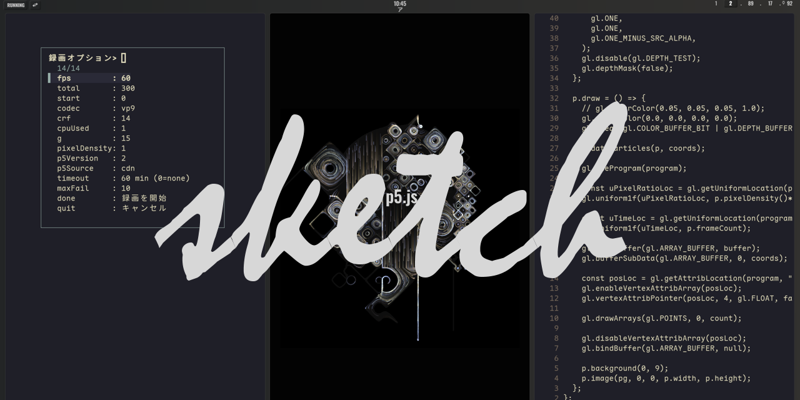

# sketch

<div align="right">
  <b>ja</b> | <a href="README.md">en</a>
</div>

日常的に書くために。

p5.js のスケッチを管理・編集するための CLI ツール。



## Quick Start

1. [Releases](https://github.com/yuruyurau/sketch/releases) から環境に合った zip をダウンロードし、バイナリを PATH の通った場所に置く
2. `~/.config/sketch/config.json` を作成する（最小限の例は下）
3. `sketch` を実行する

```json
{
  "editor": "nvim",
  "sketchDir": "~/Documents/sketches",
  "outDir": "~/Documents/sketches/record"
}
```

詳細は [docs/configuration.ja.md](docs/configuration.ja.md) を参照。

> [!NOTE]
> `config.json` が存在しない場合は起動しません。初回は必ず作成してください。

## インストール手順

ダウンロードして zip を展開後。

### Windows

「Windows によって PC が保護されました」と表示された場合は **詳細情報** → **実行** をクリック。

または PowerShell で:

```powershell
Unblock-File -Path .\sketch.exe
```

その後、PATH の通った場所へ配置します。

### macOS

隔離属性を解除して、PATH の通った場所へ配置します。

```bash
xattr -d com.apple.quarantine sketch
mv sketch /usr/local/bin/
```

### Linux

PATH の通った場所へ配置します。

```bash
mv sketch /usr/local/bin/
```

## 必要環境

| ツール / 環境                                                                                         | 用途                 | 備考                                          |
| ----------------------------------------------------------------------------------------------------- | -------------------- | --------------------------------------------- |
| [fzf](https://github.com/junegunn/fzf)                                                                | モード選択・絞り込み | インタラクティブな絞り込み                    |
| [fd](https://github.com/sharkdp/fd)                                                                   | ファイル一覧取得     | `file` モード用                               |
| [ripgrep](https://github.com/BurntSushi/ripgrep)                                                      | 内容の行一覧取得     | `fuzzy` / `exact` モード用                    |
| [bat](https://github.com/sharkdp/bat)                                                                 | プレビュー           | fzf の preview 用                             |
| ブラウザ                                                                                              | プレビュー           | 任意のモダンブラウザ                          |
| エディタ                                                                                              | 編集                 | 対応エディタのいずれか（デフォルトは `nvim`） |
| [ffmpeg](https://github.com/FFmpeg/FFmpeg)                                                            | 録画                 | `record` モード用                             |
| Chrome / Chromium または [Chrome for Testing](https://github.com/GoogleChromeLabs/chrome-for-testing) | 録画                 | `record` モード用                             |
| [Bun](https://bun.sh)                                                                                 | ビルド               | `build` モード用                              |
| [ImageMagick](https://imagemagick.org/)                                                               | コンタクトシート     | `sheet` モード用                              |

<details>
<summary>Homebrew / Scoop / Winget</summary>

**コアツール**

- **macOS (Homebrew)**
  ```bash
  brew install fzf fd ripgrep bat neovim
  ```
- **Windows (Scoop)**
  ```powershell
  scoop install fzf fd ripgrep bat neovim
  ```
- **Windows (Winget)**
  ```powershell
  winget install --id junegunn.fzf --id sharkdp.fd --id BurntSushi.ripgrep.MSVC --id sharkdp.bat --id Neovim.Neovim
  ```

**オプション**

- ffmpeg: `brew install ffmpeg` / `scoop install ffmpeg` / `winget install Gyan.FFmpeg`
- Bun: https://bun.sh
- ImageMagick: `brew install imagemagick` / `scoop install imagemagick` / `winget install ImageMagick.ImageMagick`

</details>

### 対応エディタ

- [nvim](https://github.com/neovim/neovim) / [vim](https://github.com/vim/vim) / `vi` / [neovide](https://github.com/neovide/neovide)
- [nano](https://nano-editor.org/) / [micro](https://github.com/zyedidia/micro) / [edit](https://github.com/microsoft/edit)
- [hx / helix](https://github.com/helix-editor/helix)
- [fresh](https://github.com/sinelaw/fresh)
- [zed / zeditor](https://zed.dev)
- [code / code-insiders](https://code.visualstudio.com/)

Zed / VS Code の連携設定は [docs/editors.ja.md](docs/editors.ja.md) を参照。

## 使い方

起動後、fzf でモードを選択します。

https://github.com/user-attachments/assets/37e20539-2a49-4cc4-a0ff-eb6a9a268570

| Mode   | 説明                                         |
| ------ | -------------------------------------------- |
| today  | 今日のスケッチを開く（なければ作成）         |
| fuzzy  | スケッチ内容をあいまい検索                   |
| exact  | スケッチ内容を完全一致検索                   |
| file   | ファイル名で検索                             |
| add    | 新しいスケッチを作成                         |
| record | スケッチを録画                               |
| build  | 静的 HTML にバンドル（Bun が必要）           |
| sheet  | コンタクトシートを作成（ImageMagick が必要） |
| config | config.json を開く                           |

詳細は [docs/modes.ja.md](docs/modes.ja.md) を参照。

### ファイルの置き方

普段は **1ファイル**（`YYYY-MM-DD.js` や `.mod.js`）で管理します。  
サーバーのルートは開いたファイルがあるディレクトリになるので、同じ階層やサブフォルダにあるアセット・補助スクリプトは相対パスで読めます。`../` はブロックされます。

```
~/Documents/sketches/
├── 2026-11-28.js          ← これを開くとこのディレクトリがルート
├── photo.png              ← ./photo.png で読める
└── project-a/
    ├── main.js            ← これを開くと project-a/ がルート
    └── assets/image.png   ← ./assets/image.png で読める
```

詳細は [docs/advanced.ja.md](docs/advanced.ja.md) を参照。

### 検索について

- `file` は `fd` でファイルを列挙します。
- `fuzzy` / `exact` は `ripgrep` で全行を出力します。
- 実際の絞り込みはどちらも `fzf` が行います（`exact` は `--exact` モード）。
- `.gitignore`（または `.ignore`）がある場合は除外に使われます（Git リポジトリ外でも有効）。

### fzf のキー操作

| キー                                 | 動作                                      |
| ------------------------------------ | ----------------------------------------- |
| `Ctrl+J` / `Ctrl+K` または `↑` / `↓` | 選択を移動                                |
| `Enter`                              | 決定                                      |
| `Ctrl+Q` または `Esc`                | キャンセル                                |
| `Ctrl+T`                             | プレビューの表示/非表示（検索モードのみ） |
| `Shift+J` / `Shift+K`                | プレビューをスクロール（検索モードのみ）  |
| `Tab` / `Shift+Tab`                  | 選択のトグル（sheet multi）               |

### Architecture

```
sketch
├── Interactive mode (fzf)
│   ├── today / add / file / fuzzy / exact
│   │   └── Select file → start server → open editor
│   ├── record
│   │   └── Select file + options → start recording server → chromedp + ffmpeg
│   ├── build
│   │   └── Select file + options → bundle with Bun → write static HTML
│   ├── sheet
│   │   └── Select sketch(es) + frames → capture → ImageMagick contact sheet
│   └── config
│       └── Open config.json
│
└── Server mode (--server)
    ├── Serve sketch with p5.js wrapper
    ├── Live reload via SSE
    └── File watching with fsnotify
```

## 詳細ドキュメント

- [エディタ設定](docs/editors.ja.md)
- [モード詳細](docs/modes.ja.md)
- [config.json リファレンス](docs/configuration.ja.md)
- [録画・コンタクトシート](docs/recording.ja.md)
- [ソースからのビルド](docs/building.ja.md)
- [マルチファイル / インスタンスモード](docs/advanced.ja.md)

## Related

- [vid_encode.nu](https://gist.github.com/yuruyurau/e56e2f9bbd9e0a74d7000eabc4975810)  
  creative coding向けの動画encodeスクリプト。  
  X / YouTube用に高品質で書き出せます。  
  vifmのコマンド例も記載しています。
