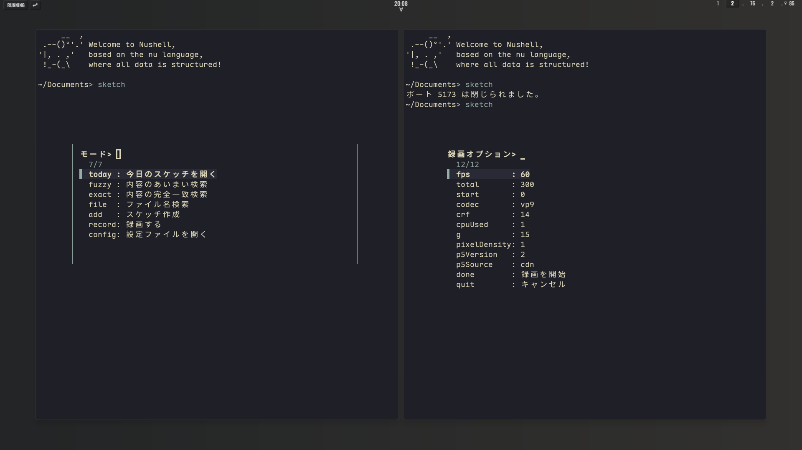

# sketch

<div align="right">
  <a href="README.ja.md">ja</a> | <b>en</b>
</div>

For writing every day.

A CLI tool for managing and editing p5.js sketches.



## Quick Start

1. Download the appropriate zip from [Releases](https://github.com/yuruyurau/sketch/releases) and put the binary on your PATH.
2. Create `~/.config/sketch/config.json` (minimal example below).
3. Run `sketch`.

```json
{
  "editor": "nvim",
  "sketchDir": "~/Documents/sketches",
  "outDir": "~/Documents/sketches/record"
}
```

Full reference: [docs/configuration.md](docs/configuration.md)

> [!NOTE]
> The tool will not start if `config.json` is missing.

## Installation

After downloading and extracting the zip.

### Windows

If you see “Windows protected your PC”, click **More info** → **Run anyway**.

Or in PowerShell:

```powershell
Unblock-File -Path .\sketch.exe
```

Then place it in a directory on your PATH.

### macOS

Remove the quarantine attribute and place it in a directory on your PATH:

```bash
xattr -d com.apple.quarantine sketch
mv sketch /usr/local/bin/
```

### Linux

Place it in a directory on your PATH:

```bash
mv sketch /usr/local/bin/
```

## Requirements

| Tool / Environment                                                                                | Purpose                    | Notes                                            |
| ------------------------------------------------------------------------------------------------- | -------------------------- | ------------------------------------------------ |
| [fzf](https://github.com/junegunn/fzf)                                                            | Mode selection & filtering | Interactive filtering                            |
| [fd](https://github.com/sharkdp/fd)                                                               | File listing               | For `file` mode                                  |
| [ripgrep](https://github.com/BurntSushi/ripgrep)                                                  | Content line listing       | For `fuzzy` / `exact` modes                      |
| [bat](https://github.com/sharkdp/bat)                                                             | Preview                    | For fzf preview                                  |
| Browser                                                                                           | Preview                    | Any modern browser                               |
| Editor                                                                                            | Editing                    | One of the supported editors (default is `nvim`) |
| [ffmpeg](https://github.com/FFmpeg/FFmpeg)                                                        | Recording                  | For `record` mode                                |
| Chrome / Chromium or [Chrome for Testing](https://github.com/GoogleChromeLabs/chrome-for-testing) | Recording                  | For `record` mode                                |
| [Bun](https://bun.sh)                                                                             | Build                      | For `build` mode                                 |
| [ImageMagick](https://imagemagick.org/) (`magick`)                                                | Contact sheet              | For `sheet` mode                                 |

<details>
<summary>Homebrew / Scoop / Winget</summary>

**Core tools**

- **macOS (Homebrew)**
  ```bash
  brew install fzf fd ripgrep bat neovim
  ```
- **Windows (Scoop)**
  ```powershell
  scoop install fzf fd ripgrep bat neovim
  ```
- **Windows (Winget)**
  ```powershell
  winget install --id junegunn.fzf --id sharkdp.fd --id BurntSushi.ripgrep.MSVC --id sharkdp.bat --id Neovim.Neovim
  ```

**Optional**

- ffmpeg: `brew install ffmpeg` / `scoop install ffmpeg` / `winget install Gyan.FFmpeg`
- Bun: https://bun.sh
- ImageMagick: `brew install imagemagick` / `scoop install imagemagick` / `winget install ImageMagick.ImageMagick`

</details>

### Supported Editors

- [nvim](https://github.com/neovim/neovim) / [vim](https://github.com/vim/vim) / `vi` / [neovide](https://github.com/neovide/neovide)
- [nano](https://nano-editor.org/) / [micro](https://github.com/zyedidia/micro) / [edit](https://github.com/microsoft/edit)
- [hx / helix](https://github.com/helix-editor/helix)
- [fresh](https://github.com/sinelaw/fresh)
- [zed / zeditor](https://zed.dev)
- [code / code-insiders](https://code.visualstudio.com/)

Zed / VS Code setup: [docs/editors.md](docs/editors.md)

## Usage

On launch you select a mode with fzf.

https://github.com/user-attachments/assets/37e20539-2a49-4cc4-a0ff-eb6a9a268570

| Mode   | Description                                      |
| ------ | ------------------------------------------------ |
| today  | Open today’s sketch. Create if it doesn’t exist. |
| fuzzy  | Fuzzy search in sketch contents                  |
| exact  | Exact search in sketch contents                  |
| file   | Search by filename                               |
| add    | Create a new sketch                              |
| record | Record a sketch                                  |
| build  | Bundle into static HTML (requires Bun)           |
| sheet  | Create a contact sheet (requires ImageMagick)    |
| config | Open config.json                                 |

See [docs/modes.md](docs/modes.md) for details.

### About search

- `file` uses `fd` to list files.
- `fuzzy` / `exact` use `ripgrep` to output all lines.
- Actual filtering is done by `fzf` in both cases (`exact` uses `--exact` mode).
- If `.gitignore` (or `.ignore`) exists, it is respected for exclusion (effective even outside a Git repository).

### fzf Keybindings

| Key                              | Action                             |
| -------------------------------- | ---------------------------------- |
| `Ctrl+J` / `Ctrl+K` or `↑` / `↓` | Move selection                     |
| `Enter`                          | Confirm                            |
| `Ctrl+Q` or `Esc`                | Cancel                             |
| `Ctrl+T`                         | Toggle preview (search modes only) |
| `Shift+J` / `Shift+K`            | Scroll preview (search modes only) |

### Architecture

```
sketch
├── Interactive mode (fzf)
│   ├── today / add / file / fuzzy / exact
│   │   └── Select file → start server → open editor
│   ├── record
│   │   └── Select file + options → start recording server → chromedp + ffmpeg
│   ├── build
│   │   └── Select file + options → bundle with Bun → write static HTML
│   ├── sheet
│   │   └── Select sketch(es) + frames → capture → ImageMagick contact sheet
│   └── config
│       └── Open config.json
│
└── Server mode (--server)
    ├── Serve sketch with p5.js wrapper
    ├── Live reload via SSE
    └── File watching with fsnotify
```

## Further Reading

- [Editor setup](docs/editors.md)
- [Mode details](docs/modes.md)
- [config.json reference](docs/configuration.md)
- [Recording & Contact Sheet](docs/recording.md)
- [Building from source](docs/building.md)
- [Using multiple files / instance mode](docs/advanced.md)
